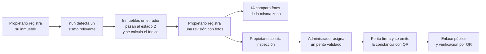
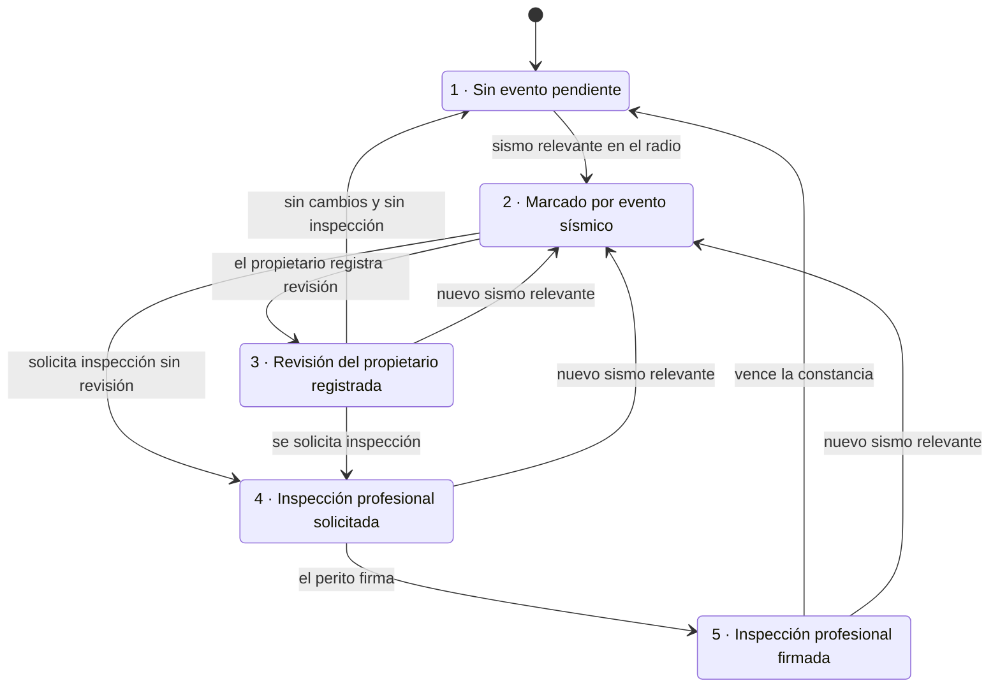
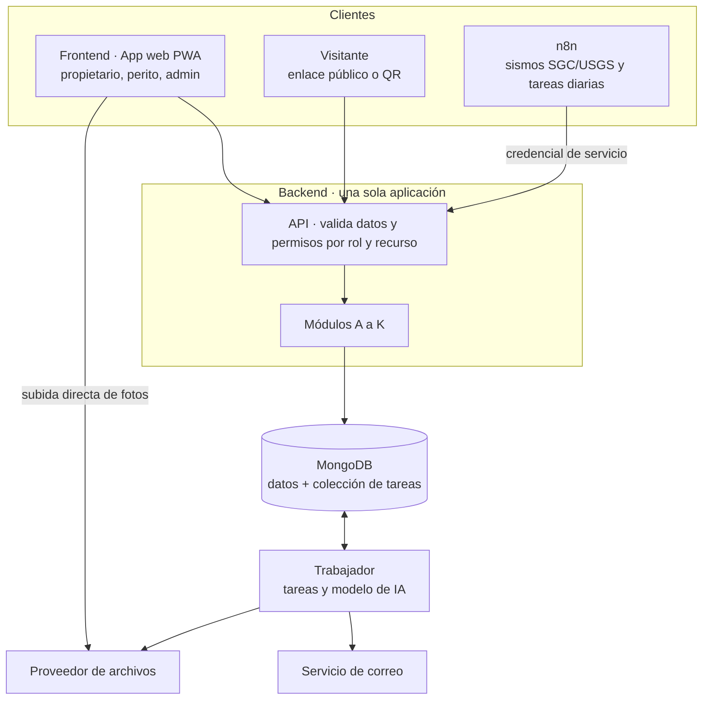

# SafeTrace

**Historia clínica verificable del inmueble.**

SafeTrace guarda la historia de cada inmueble: sus datos, mantenimientos, daños, fotos, los sismos que lo afectaron y las inspecciones firmadas por peritos. Cuando ocurre un sismo relevante, marca los inmuebles cercanos, avisa a sus propietarios y guía el proceso de revisión hasta una constancia verificable por código QR.

> SafeTrace **no** declara que un inmueble sea seguro, inseguro o habitable, no emite diagnósticos estructurales ni certifica la NSR-10. La IA hace triaje, no diagnóstico, y nunca cambia el estado de un inmueble por sí sola.

Proyecto integrador de Ingeniería de Software (semestre 8) · CIAF — Educación Superior · Pereira, Colombia · 2026.

---

## Contenido

- [Qué hace](#qué-hace)
- [Flujo central](#flujo-central)
- [Estados del inmueble](#estados-del-inmueble)
- [Roles](#roles)
- [Arquitectura](#arquitectura)
- [Stack](#stack)
- [Estructura del repositorio](#estructura-del-repositorio)
- [Cómo arrancar](#cómo-arrancar)
- [Reglas del equipo](#reglas-del-equipo)
- [Flujo de trabajo y metodología](#flujo-de-trabajo-y-metodología)
- [Alcance del MVP](#alcance-del-mvp)
- [Documentación](#documentación)
- [Equipo](#equipo)

---

## Qué hace

| Módulo | Qué permite | Requerimientos |
|---|---|---|
| A · Cuentas y administración | Registro, sesión, consentimiento de datos, gestión de usuarios, auditoría y configuración | RF-01 a RF-12 |
| B · Peritos | Perfil profesional, documentos y validación de credenciales | RF-13 a RF-16 |
| C · Inmuebles | Registro del inmueble con ubicación y datos de construcción | RF-17 a RF-21 |
| D · Bitácora y evidencias | Eventos, fotos, documentos y línea cronológica | RF-22 a RF-27 |
| E · Revisión del propietario | Revisiones con fotos y recordatorio semestral | RF-28 a RF-30 |
| F · Sismos | Consulta automática al SGC y al USGS, sismos relevantes e inmuebles afectados | RF-31 a RF-37 |
| G · Estados del inmueble | Las cinco etapas del proceso de revisión y su historial | RF-38 a RF-47 |
| H · Inspecciones y constancias | Solicitud, asignación de perito, firma, versiones y constancia con QR | RF-48 a RF-58 |
| I · Enlace público | Enlace de solo lectura con la información que elige el propietario | RF-59 a RF-61 |
| J · IA e índice de priorización | Comparación de fotos con IA e índice orientativo para priorizar revisiones | RF-62 a RF-68 |
| K · Notificaciones y procesos | Correos y estado de las tareas en segundo plano | RF-69 a RF-71 |

La especificación completa (71 RF y 37 RNF) está en la ERS v2.

## Flujo central



## Estados del inmueble

Los estados describen la etapa del proceso de revisión, **nunca** la seguridad del inmueble. Solo el módulo G puede cambiarlos.



Casos especiales:

- Una revisión fuera del flujo sísmico (por ejemplo, la semestral) se guarda sin cambiar el estado.
- Si el perito firma después de que un sismo nuevo devolvió el inmueble al 2, la firma se guarda pero el estado no cambia (pendiente de confirmar).
- Al vencer la constancia, se marca como vencida siempre, pero el inmueble solo vuelve al 1 si sigue en el 5.
- Dos cambios simultáneos no se pisan: el cambio se guarda solo si el estado sigue siendo el esperado.

## Roles

| Rol | Qué hace |
|---|---|
| Propietario | Registra inmuebles, eventos, fotos y revisiones; solicita inspecciones; comparte enlaces públicos |
| Perito | Registra su perfil profesional; una vez validado, registra y firma las inspecciones asignadas |
| Administrador general | Valida peritos, asigna inspecciones, gestiona usuarios, configuración y auditoría. No puede modificar historial, evidencias ni inspecciones firmadas |
| Visitante (sin cuenta) | Ve la información que el propietario autorizó y verifica constancias por código o QR. Nunca ve el estado ni datos personales |

## Arquitectura



Ideas clave:

- **Un backend, 11 módulos.** Cada módulo es dueño de sus colecciones y ofrece a los demás solo lo que expone en su `interfaz.py`.
- **Lo lento va a la cola.** La comparación de fotos y los correos se registran en la colección `tareas` y los procesa el trabajador. El usuario recibe respuesta en menos de 3 segundos.
- **Las fotos no pasan por el servidor.** El navegador las sube directo al proveedor con una autorización temporal; la base guarda solo la referencia y su huella.
- **Lo firmado no se edita.** Inspecciones firmadas, evidencias e historial solo se agregan; una corrección crea una versión nueva.
- **Si un servicio externo falla, lo demás sigue funcionando.**

## Stack

| Pieza | Tecnología |
|---|---|
| Backend | Python 3.12+ · FastAPI · Pydantic |
| Base de datos | MongoDB (índice geoespacial `2dsphere`, transacciones) · Atlas en la nube |
| Cola de tareas | Colección `tareas` de MongoDB + trabajador en Python |
| Automatización | n8n: consulta de sismos (cada 5 min o menos) y tareas diarias |
| IA | Modelo entrenado en Google Colab, ejecutado por el trabajador |
| Archivos | Proveedor externo de imágenes y documentos |
| Frontend | Aplicación web progresiva (PWA) · *framework por confirmar en `frontend/README.md`* |
| Calidad | pytest · ruff · GitHub Actions |
| Local | Docker Compose (MongoDB como conjunto de réplicas) |

## Estructura del repositorio

```
safetrace/
├── backend/                 # API FastAPI, trabajador y scripts de base de datos
│   ├── app/
│   │   ├── core/            #   configuración, conexión, seguridad, permisos, auditoría
│   │   ├── modulos/         #   cuentas, peritos, inmuebles, bitacora, revisiones, sismos,
│   │   │                    #   estados, inspecciones, enlaces, ia_indice, notificaciones
│   │   ├── integraciones/   #   proveedor de archivos y correo
│   │   └── trabajador/      #   ejecuta la colección `tareas`
│   ├── db/                  #   índices, semillas, validadores y migraciones
│   ├── tests/
│   ├── docker-compose.yml
│   └── README.md            #   detalle del backend
├── frontend/                # aplicación web (PWA)
│   └── README.md            #   detalle del frontend
├── n8n/                     # flujos exportados de n8n
├── docs/                    # ERS, arquitectura, base de datos y diagramas UML
│   ├── ers/
│   ├── arquitectura/
│   ├── base-de-datos/
│   └── diagramas/
├── .github/workflows/       # integración continua de backend y frontend
├── .gitignore
└── README.md                # este archivo
```

Cada módulo del backend tiene los mismos cinco archivos:

| Archivo | Responsabilidad |
|---|---|
| `rutas.py` | Endpoints. Validan datos y permisos y llaman al servicio |
| `esquemas.py` | Modelos de entrada y salida |
| `servicio.py` | Reglas de negocio (aquí se concentran las pruebas) |
| `repositorio.py` | Acceso a MongoDB, solo a las colecciones del módulo |
| `interfaz.py` | Lo que el módulo ofrece a los demás |

## Cómo arrancar

Requisitos: Git, Python 3.12+, Docker Desktop (o una cuenta de MongoDB Atlas) y Visual Studio Code.

```bash
git clone https://github.com/<organizacion>/safetrace.git
cd safetrace/backend
```

**Backend** — en Windows (cmd):

```cmd
python -m venv .venv
.venv\Scripts\activate
pip install -r requirements-dev.txt
copy .env.example .env
docker compose up -d
python -m db.indices
python -m db.semillas
uvicorn app.main:app --reload
```

En macOS o Linux cambian dos líneas: `source .venv/bin/activate` y `cp .env.example .env`.

Abre http://localhost:8000/docs para ver todos los endpoints agrupados por módulo. Los que aún no se construyen responden `501 Pendiente de implementar`.

| Tarea | Comando (desde `backend/`) |
|---|---|
| Trabajador | `python -m app.trabajador.main` |
| Pruebas | `pytest` |
| Estilo | `ruff check .` y `ruff format .` |

**Frontend:** ver [`frontend/README.md`](frontend/README.md).

**Variables de entorno:** cada carpeta tiene su `.env.example`. El archivo `.env` real nunca se sube al repositorio.

## Reglas del equipo

Arquitectura:

1. Un módulo solo importa la `interfaz.py` de otro, nunca su `servicio.py` ni su `repositorio.py`.
2. Cada colección de MongoDB tiene un único módulo dueño.
3. Solo el módulo G cambia el estado del inmueble. La IA y el índice nunca lo hacen.
4. Nada de datos personales (nombre, documento, correo, teléfono) en logs, tareas ni auditoría.

Interfaz (frontend):

5. Colores principales azul, blanco y gris claro. Rojo o naranja solo para alertas o daños; verde solo para «operación completada» o «constancia verificada». Sin semáforos para los estados.
6. Nunca usar las palabras «seguro», «inseguro» o «habitable» para describir un inmueble.
7. Mostrar siempre el origen de cada dato: registro del usuario, «Análisis automático mediante IA» o evaluación firmada de un perito.
8. El índice de priorización siempre va con sus variables y el aviso «orientativo, no es una evaluación profesional».
9. El enlace público y el QR nunca muestran el estado del inmueble ni datos personales.

## Flujo de trabajo y metodología

El equipo trabaja con **Scrumban**: roles, backlog, Definition of Ready y Definition of Done de Scrum, sin sprints. El trabajo fluye por el tablero con un límite de 2 tarjetas por persona.

```
Backlog → Listo → En desarrollo → En revisión de código → En pruebas → Hecho
```

Ramas y cambios:

- `main` siempre funciona. Nadie sube cambios directo a `main`.
- Una rama por tarjeta: `feat/<modulo>-<descripcion>`, `fix/<modulo>-<descripcion>` o `docs/<tema>`.
  Ejemplo: `feat/b-validar-credenciales`.
- Cada cambio entra por un pull request revisado por otro integrante y con la integración continua en verde.
- Mensajes de commit en español y en presente: `Agrega validación de credenciales del perito (RF-15)`.
- Referenciar en el pull request el RF o RNF que se cumple.

## Alcance del MVP

Entrega de trabajo: **25 de noviembre de 2026**.

- **Prioridad Alta (44 RF):** obligatorios; forman el flujo central.
- **Prioridad Media (27 RF):** entran si el ritmo del equipo lo permite.

Orden de construcción por dependencias:

| Orden | Módulos |
|---|---|
| 1 | A · Cuentas, B · Peritos, C · Inmuebles, D · Bitácora |
| 2 | E · Revisión, F · Sismos, G · Estados |
| 3 | H · Inspecciones, I · Enlace público, J · IA e índice |
| 3–4 | K · Notificaciones |

**Fuera del MVP (roadmap):** administrador de propiedad horizontal y copropiedades, suscripciones y pagos, reportes, cambio de propietario, modo sin conexión, mapa, registro manual de sismos y validación de credenciales contra registros oficiales.

## Documentación

| Documento | Contenido |
|---|---|
| ERS v2 — Requerimientos corregidos | 71 RF, 37 RNF, alcance, roadmap y metodología |
| SafeTrace — Arquitectura del backend | Módulos, flujo, estados, permisos, tareas, seguridad y stack |
| Diseño DataBase V2 | 20 colecciones de MongoDB, esquemas, índices, integridad y respaldo |
| Diagramas UML v2 | Casos de uso, actividades, secuencia y estados (módulos J y B) y modelo de dominio global |
| `backend/README.md` | Cómo trabajar en el backend |

Los documentos se guardan en [`docs/`](docs/).

## Equipo

| Integrante | Rol |
|---|---|
| María Fernanda García Carvajal | Product Owner y líder técnica · full-stack y QA |
| Juan Miguel Yepes Zapata | Líder de QA y pruebas · full-stack y back-end |
| Jeferson Ríos Ríos | Arquitecto de datos y DevOps · full-stack y back-end |
| Nicolás Giraldo Ramírez | Soporte de base de datos y DevOps · full-stack, front-end y back-end |
| Valeria Olarte | Diseñadora UX/UI y soporte de base de datos · full-stack y front-end |
| Brayan Velásquez | Scrum Master y diseñador UX/UI · full-stack y front-end |

**CIAF — Educación Superior** · Ingeniería de Software, semestre 8 · Pereira, Colombia.

---

Proyecto académico. Su uso fuera del curso requiere autorización del equipo.
